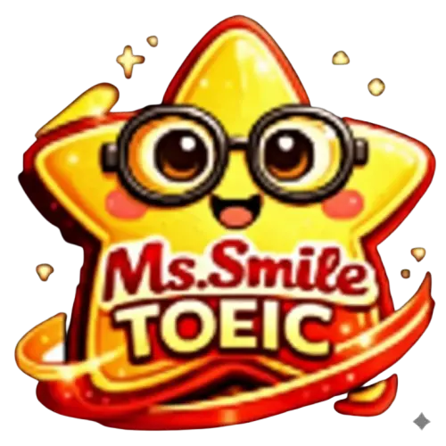

# Ms.Smile TOEIC · Học liệu & Trợ lý AI Luyện Nói 🗣️

> **Nền tảng học liệu tiếng Anh và luyện kỹ năng TOEIC thông minh kết hợp trợ lý AI đa phương thức (Ms.Smile TOEIC). Cung cấp cổng thông tin khóa học, bài giảng và quản trị nội dung linh hoạt trên nền Supabase, kết hợp dịch vụ trí tuệ nhân tạo (Local LLM via Ollama + Edge-TTS) hỗ trợ phân tích phát âm, hướng dẫn ngắt nghỉ, ngữ điệu và sinh hội thoại tương tác cho người học.**

**Dự án của Toàn Nguyễn** · Nền tảng EdTech & Tích hợp Trí tuệ Nhân tạo (AI-Powered Learning)

[Xem tính năng](#features) · [Tài liệu kỹ thuật & cài đặt](TECHNICAL.md)

  

---

## 🌟 Trải Nghiệm Trực Tuyến (Live Website)

- **Cổng thông tin & học liệu:** [https://nhttoan0809.github.io/toeic-speaking-practice/](https://nhttoan0809.github.io/toeic-speaking-practice/)

---

## 📌 Executive Summary (Tổng quan dự án)

| Thông số               | Chi tiết                                                                       |
| :--------------------- | :----------------------------------------------------------------------------- |
| **Project Name**       | **TOEIC Speaking Practice / Ms.Smile TOEIC**                                   |
| **Project Type**       | Nền tảng học ngoại ngữ trực tuyến kết hợp thử nghiệm mô hình ngôn ngữ lớn (AI) |
| **Đối tượng sử dụng**  | Học viên luyện thi TOEIC và đội ngũ biên tập/quản lý nội dung học liệu         |
| **Phạm vi phát triển** | Cổng tài liệu, CMS quản lý bài viết/banner và microservices AI phân tích ngôn ngữ |
| **Trạng thái**         | Hoàn thiện cổng thông tin và trang CMS; microservices AI đang thử nghiệm độc lập|

---

## 🎯 Problem & Solution (Bài toán & Giải pháp)

- **Problem:** Tự luyện thi TOEIC Speaking thường gặp khó khăn do thiếu môi trường phản hồi: học viên khó tự nhận biết cách ngắt nhịp, ngữ điệu tự nhiên của câu và thiếu giáo viên bản xứ để đối thoại luyện tập hàng ngày với chi phí hợp lý.
- **Solution:** Xây dựng hệ sinh thái gồm: Cổng web học liệu trực quan cho học viên tra cứu bài giảng; trang quản trị (CMS) vận hành bài viết/sự kiện qua Supabase; và chuỗi dịch vụ AI chuyên biệt (FastAPI + Ollama + Edge-TTS) có khả năng sinh ngữ cảnh hội thoại, tách nhịp văn bản ngữ âm (IPA) và tạo âm thanh mẫu hỗ trợ người học nghe - nhại lại chuẩn xác.

---

## ✨ Key Features (Tính năng nổi bật)

| Thành phần                             | Giá trị và mức độ sẵn sàng                                                                                          |
| :------------------------------------- | :------------------------------------------------------------------------------------------------------------------ |
| **Cổng học liệu tương tác**            | Khám phá kho tài liệu ôn luyện theo chủ đề, cập nhật tin tức khóa học và lịch khai giảng nhanh chóng                |
| **CMS quản lý nội dung linh hoạt**     | Đăng tải, chỉnh sửa bài viết chuyên môn và cập nhật biểu ngữ (banner) trực tiếp qua giao diện quản trị              |
| **Hội thoại thông minh (AI Chat)**     | Mô hình LLM cục bộ (Ollama) đóng vai trò người bản xứ, tạo câu trả lời phản xạ tự nhiên theo chủ đề thi TOEIC      |
| **Phân tích ngữ điệu & Ngắt nghỉ**     | Trợ lý phân tích cấu trúc câu tiếng Anh, đánh dấu vị trí ngắt câu, ngữ điệu lên xuống và phiên âm IPA hướng dẫn đọc |

**Mốc tiếp theo:** Đưa các công cụ hỗ trợ vào cùng hành trình học. Hiện trang luyện Speaking & Writing vẫn hiển thị “Coming Soon”; chưa có thu âm hay chấm điểm phát âm.

---

## 👨‍💻 Competencies & Contributions (Năng lực & Đóng góp)

- **Hiểu nhu cầu người dùng:** Kết hợp góc nhìn của người học với nhu cầu cập nhật nội dung của người quản lý.
- **Phát triển ứng dụng nhiều thành phần:** Xây dựng trải nghiệm nội dung và các công cụ AI có thể tiếp tục kết nối với nhau.
- **Ứng dụng AI có mục tiêu:** Thử nghiệm sinh văn bản, giọng nói và gợi ý cách đọc gắn với bối cảnh học ngoại ngữ.
- **Xác định phạm vi sản phẩm:** Phân biệt phần đã có với hành trình học còn cần hoàn thiện.

---

## 📈 Future Roadmap (Hướng phát triển)

- [ ] Kết nối công cụ AI vào trang luyện tập.
- [ ] Hoàn thiện các dạng bài Speaking & Writing.
- [ ] Xây dựng tiêu chí đánh giá kết quả học tập.

---

## 👤 Author & Contact

- **Tác giả:** Toàn Nguyễn
- **GitHub:** [@nhttoan0809](https://github.com/nhttoan0809)
- **Tài khoản sinh viên (cùng tác giả):** [@toanb1805926](https://github.com/toanb1805926)

---

## 📄 License

Xem [thông tin giấy phép và tài nguyên bên thứ ba](TECHNICAL.md#license).
