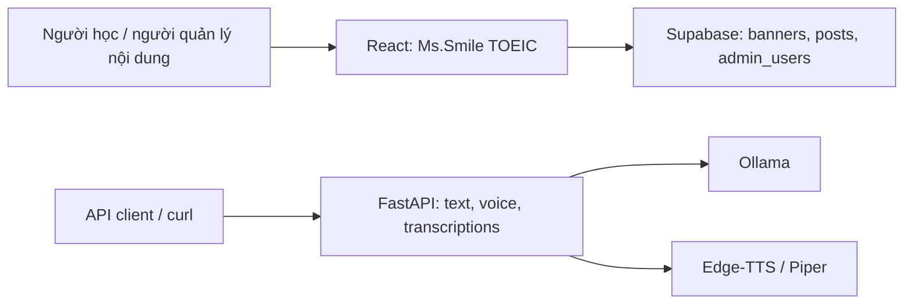

# Technical Guide · TOEIC Speaking Practice

[Tổng quan dự án và năng lực thể hiện](README.md)

Tài liệu dành cho lập trình viên và agents: phạm vi triển khai, công nghệ, kiến trúc, cấu hình và cách kiểm tra. Các đường dẫn tương đối bắt đầu từ thư mục gốc repository.

[Phạm vi](#scope) · [Skills & Tech Stack](#stack) · [Kiến trúc & API](#architecture) · [Cài đặt](#setup) · [Điểm kỹ thuật](#highlights) · [Hướng cải thiện](#roadmap) · [Tham khảo](#references) · [Giấy phép](#license)

<a id="scope"></a>

## 📍 Implementation Scope (Phạm vi triển khai)

Ba thành phần hiện tại là `frontend`, `api_services` và `llm_services`. Frontend chỉ gọi Supabase, chưa kết nối API luyện nói. Trang Speaking & Writing là Coming Soon; các router mô tả ảnh và trả lời câu hỏi chưa có endpoint. Chưa có thu âm, speech-to-text hoặc chấm điểm phát âm.

Frontend đọc slogan đang bật từ `banners`, bài viết từ `posts`, và có dashboard quản lý. Login truy vấn trực tiếp `admin_users` bằng username/password, sau đó lưu `admin_auth` trong `localStorage`. Đây là xác thực mẫu ở client; cần thay bằng cơ chế xác thực phù hợp và RLS trước khi dùng với dữ liệu quản trị thực tế.

API text nhận lịch sử hội thoại và trả JSON. API voice sinh đầy đủ câu trả lời rồi trả bytes âm thanh, chưa stream audio. Endpoint transcriptions nhận văn bản để gợi ý ngắt nghỉ, ngữ điệu và phiên âm; không nhận file audio. Prompt mặc định nằm tại [transcriptions.txt](api_services/app/prompts/transcriptions.txt); kết quả LLM chưa có bộ đánh giá ngữ âm.

Thư viện standalone có ví dụ text, streaming text, text kèm audio và streaming text rồi phát audio khi thu thập xong. Streaming mới thuộc thư viện/CLI, chưa có endpoint SSE/WebSocket cho frontend. URL Pages được khai báo trong `frontend/package.json`, nhưng chưa xác minh trạng thái online.

---

<a id="stack"></a>

## 🛠 Skills & Tech Stack (Kỹ năng & Công nghệ)

| Tầng kiến trúc               | Công nghệ chính                                    | Lý do phù hợp với triển khai hiện tại                                                       |
| :--------------------------- | :------------------------------------------------- | :------------------------------------------------------------------------------------------ |
| **Frontend**                 | React 19, TypeScript 5.9, React Router 7           | Trang nội dung, route quản trị và kiểu dữ liệu banner/post                                  |
| **Styling & Motion**         | Tailwind CSS 4, Framer Motion, Lucide              | Layout responsive, modal, menu và hiệu ứng chữ                                              |
| **Data**                     | Supabase JS 2                                      | Frontend đọc/ghi trực tiếp các bảng nội dung                                                |
| **API**                      | Python, FastAPI, Pydantic, Uvicorn                 | Validation request, OpenAPI và trả JSON/âm thanh                                            |
| **LLM**                      | Ollama, model cấu hình bằng biến môi trường        | Sinh văn bản local và quản lý lịch sử hội thoại                                             |
| **TTS**                      | Edge-TTS, Piper                                    | Hai lựa chọn online/local; Piper cần model riêng                                            |
| **Build & Tools**            | Rolldown Vite 7.2.5, npm, ESLint                   | Build frontend, lint và script publish Pages                                                |
| **Packaging / Verification** | Dockerfile/Compose có sẵn, script kiểm tra LLM/TTS | Cấu hình container cần sửa đường dẫn trước khi dùng; chưa có bộ test tích hợp toàn hệ thống |

LLM chạy local qua Ollama không có nghĩa toàn hệ thống offline: frontend dùng Supabase và Edge-TTS cần Internet. Bộ `requirements.txt` của API và LLM ghim một số phiên bản khác nhau; không cài chồng hai bộ vào cùng môi trường.

---

<a id="architecture"></a>

## 🏗 System Architecture & API Design (Kiến trúc & Thiết kế API)



```text
toeic-speaking-practice/
├── frontend/       React SPA, Supabase và trang quản trị
├── api_services/   FastAPI, request/response, prompt và adapter
└── llm_services/   Config, engine, services, ví dụ CLI và script xác minh
```

Frontend hiện chỉ gọi Supabase; chưa có request nối giao diện luyện nói tới các endpoint sau:

| Method | Endpoint                 | Contract hiện tại                                                                       |
| :----- | :----------------------- | :-------------------------------------------------------------------------------------- |
| `GET`  | `/health`                | `{ "status": "healthy" }`                                                               |
| `POST` | `/api/v1/chat/text`      | `messages`, `system_prompt` tùy chọn → JSON có `status_code`, `message`, `data.message` |
| `POST` | `/api/v1/chat/voice`     | Cùng request hội thoại → bytes âm thanh, header `audio/mpeg`                            |
| `POST` | `/api/v1/transcriptions` | Văn bản hội thoại → gợi ý ngắt nghỉ/phiên âm do LLM sinh                                |
| `GET`  | `/docs`, `/redoc`        | Tài liệu API tự sinh                                                                    |

`picture.py` và `questions.py` chưa có endpoint. Route frontend được định nghĩa dưới `/toeic-speaking-practice`, gồm trang chủ, `/speaking-writing`, `/admin/login` và `/admin`.

---

<a id="setup"></a>

## 🚀 Getting Started (Cài đặt & Chạy thử)

### Điều kiện tiên quyết (Prerequisites)

- Node.js/npm tương thích phiên bản Vite trong frontend; repo chưa khóa Node bằng `.nvmrc`/`engines`.
- Python 3.11+ nếu dùng cả bộ dependency LLM standalone hiện tại; dùng virtualenv riêng cho từng phần.
- Ollama được cài trên máy, model đủ bộ nhớ/RAM và Internet nếu dùng Edge-TTS.
- Supabase project cùng bảng và policy phù hợp để chạy frontend. Repo chưa có SQL migration/seed.

### Các bước cài đặt (Quick Steps)

1. **Clone repository:**

   ```bash
   git clone https://github.com/nhttoan0809/toeic-speaking-practice.git
   cd toeic-speaking-practice
   ```

2. **Cấu hình và chạy frontend:**

   ```bash
   cd frontend
   npm ci
   cp .env.example .env.local
   ```

   Điền `VITE_SUPABASE_URL` và `VITE_SUPABASE_ANON_KEY` của project trong `.env.local`. Client được khởi tạo ngay khi import nên không thể chạy bình thường với hai giá trị trống. Các trường được mã nguồn sử dụng:

   | Bảng          | Trường được sử dụng                                                 |
   | :------------ | :------------------------------------------------------------------ |
   | `banners`     | `id`, `text`, `is_active`, `created_at`                             |
   | `posts`       | `id`, `image_url`, `content`, `link`, `created_at`                  |
   | `admin_users` | `username`, `password` — cơ chế mẫu cần thay trước khi dùng thực tế |

   Thiết lập schema, giá trị mặc định và policy trên Supabase theo môi trường của bạn; danh sách trên phản ánh client, không phải migration đầy đủ. Dùng anon key phía client, không đặt service-role key vào biến `VITE_*`.

   ```bash
   npm run dev
   ```

   Mở `http://localhost:5173/toeic-speaking-practice/` hoặc cổng Vite in trên terminal. Build/preview từ thư mục `frontend`:

   ```bash
   npm run lint
   npm run build
   npm run preview
   ```

   Preview thường dùng cổng `4173`, vẫn truy cập với prefix `/toeic-speaking-practice/`.

3. **Chuẩn bị Ollama** ở terminal riêng:

   ```bash
   ollama serve
   ```

   Khi daemon đã chạy, tải model bằng terminal khác:

   ```bash
   ollama pull mistral-small
   ```

   Nếu đổi model, cập nhật `LLM_MODEL_NAME` trong `.env` của API cho khớp.

4. **Cấu hình và chạy API**, bắt đầu từ thư mục gốc repo:

   ```bash
   cd api_services
   python3 -m venv .venv
   source .venv/bin/activate
   python -m pip install -r requirements.txt
   cp .env.example .env
   python -m uvicorn app.main:app --host 127.0.0.1 --port 8000 --reload
   ```

   Đường dẫn thực tế dùng dấu gạch dưới: `api_services`, `llm_services`. `app/core/config.py` thêm thư mục `llm_services` vào Python import path; cần giữ hai thư mục dịch vụ cùng cấp như trong repo. Dùng `TTS_ENGINE=edge-tts` như file mẫu để không cần model Piper; nếu chọn Piper, phải cung cấp model và kiểm tra định dạng âm thanh trả về.

5. **Kiểm tra API** tại `http://localhost:8000/docs` hoặc bằng terminal:

   ```bash
   curl http://127.0.0.1:8000/health
   curl -X POST http://127.0.0.1:8000/api/v1/chat/text \
     -H 'Content-Type: application/json' \
     -d '{"messages":[{"role":"user","content":"Give me one short English sentence about work."}]}'
   ```

   Endpoint voice dùng cùng request tại `/api/v1/chat/voice`; thêm `--output response.mp3` để lưu bytes âm thanh khi dùng Edge-TTS.

### Chạy thư viện LLM độc lập

Từ terminal mới tại gốc repo, dùng virtualenv riêng để tránh xung đột phiên bản với API:

```bash
cd llm_services
python3 -m venv .venv
source .venv/bin/activate
python -m pip install -r requirements.txt
python examples/01_basic_text.py
python examples/02_streaming_text.py
python tests/verify_llm.py
```

Ví dụ `03_text_with_audio.py`, `04_streaming_and_audio.py` import `pygame` để phát âm thanh nhưng dependency này chưa được khai báo trong requirements. Cần bổ sung `pygame` trong môi trường standalone nếu chạy các ví dụ đó. Các script xác minh cần Ollama/TTS thực tế; không phải bộ test offline hoàn chỉnh.

### Giới hạn cấu hình triển khai hiện tại

- [docker-compose.yml](api_services/docker-compose.yml) mount `../llm-services` trong khi thư mục thật là `../llm_services`; import path trong container cũng cần khớp. Chưa dùng Compose hiện tại như quy trình chạy thành công đã được xác nhận.
- Workflow GitHub Pages nằm trong [frontend/.github/workflows/deploy.yml](frontend/.github/workflows/deploy.yml), chưa ở `.github/workflows` tại gốc repo nên không được GitHub tự nhận cho monorepo này. Khi chuyển workflow cần chỉnh working directory/cache và runtime tương thích.
- Các README thành phần được giữ làm tài liệu chuyên sâu, nhưng có đường dẫn/tuyên bố cũ. Dùng hướng dẫn trong TECHNICAL.md này để định vị thư mục và phân biệt phần đã triển khai.

---

<a id="highlights"></a>

## 🔍 Implementation Highlights (Điểm kỹ thuật & Module)

- **Các module triển khai:**
  - [frontend/src](frontend/src): trang nội dung, quản trị, kết nối Supabase và UI components.
  - [api_services/app](api_services/app): API, model request/response, nạp prompt và adapter gọi LLM/TTS.
  - [llm_services/core](llm_services/core), [services](llm_services/services), [config](llm_services/config): tách engine inference, quản lý hội thoại và tổng hợp giọng nói.
- **Thử thách kỹ thuật (Key Technical Challenge):** Dùng chung dịch vụ LLM/TTS giữa CLI và API mà không trộn logic giao diện vào engine. Adapter API đóng gói cấu hình và gọi service/engine; vẫn cần chuẩn hóa packaging Python và đồng bộ dependency. Chưa có benchmark latency hoặc bằng chứng chấm điểm TOEIC.

---

<a id="roadmap"></a>

## 📈 Learnings & Technical Roadmap (Bài học & Hướng cải thiện)

### Bài học rút ra (Key Learnings)

- Tách giao diện nội dung khỏi API inference và engine LLM/TTS để có thể dùng độc lập.
- Phân biệt streaming text trong thư viện với khả năng streaming thực sự của HTTP API.
- Cần quản lý schema, quyền truy cập dữ liệu và xác thực ngoài việc chặn route ở client.
- Đường dẫn import và phiên bản dependency phải nhất quán khi chuyển từ thư mục dịch vụ riêng sang monorepo.

### Kế hoạch nâng cấp (Roadmap)

Các mục sau là đề xuất dựa trên các phần còn thiếu trong mã nguồn hiện tại.

- [ ] Kết nối trang Speaking & Writing với API, bổ sung trạng thái tải/lỗi và phát âm thanh.
- [ ] Hoàn thiện bài tập mô tả ảnh, trả lời câu hỏi và cơ chế đánh giá có tiêu chí kiểm chứng.
- [ ] Thay đăng nhập mẫu bằng xác thực phù hợp; bổ sung RLS và migration/seed Supabase.
- [ ] Chuẩn hóa Python packaging, dependency và đường dẫn Docker Compose.
- [ ] Chuyển workflow về gốc repo và cấu hình CI theo từng thư mục dịch vụ.
- [ ] Thêm kiểm thử API/UI, screenshot/GIF và tài liệu triển khai có thể tái lập.

---

<a id="references"></a>

## 📚 References (Tài liệu liên quan)

- [Frontend README](frontend/README.md), [API README](api_services/README.md), [LLM README](llm_services/README.md): tài liệu thành phần; một số mô tả còn theo phiên bản cũ.
- [API model và request](api_services/app/models), [LLM/TTS examples](llm_services/examples).

---

<a id="license"></a>

## 📄 License

README cũ của `api_services` và `llm_services` ghi MIT, nhưng repo chưa có file `LICENSE` xác nhận phạm vi và điều khoản phân phối. Cần bổ sung giấy phép chính thức trước khi khẳng định toàn repo được cấp phép MIT.
